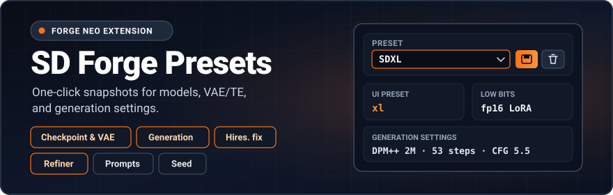

<p align="center">
  
</p>

# SD Forge Presets

Save, organize, and switch **Configuration presets** (`txt2img` and `img2img`) directly from the Quicksettings bar in **SD WebUI Forge - Neo**.

---

## Key Features

- **Per-Tab Preset Filtering:** Switching between `txt2img` and `img2img` filters the **Preset** dropdown to show only presets saved for the active tab.
- **Selective Section Snapshots:** Choose which sections to save or update in each preset:
  - `Checkpoint & VAE` (`UI Preset`, `Checkpoint`, `VAE / Text Encoder`, `Diffusion in Low Bits`)
  - `Generation Settings` (sampler, scheduler, steps, dimensions, CFG/distilled CFG, img2img & Soft Inpainting controls)
  - `Hires. fix` (`txt2img` Hires. fix toggle, upscaler, steps, scale, checkpoint/VAE/sampler overrides)
  - `Refiner` (enable toggle, refiner checkpoint, switch at, refiner CFG)
  - `Prompts` (prompt, negative prompt, styles, hires prompt/negative prompt)
  - `Seed` (seed, subseed controls, resize from width/height)

- **Local Storage:** Presets are stored as readable `.json` files in `extensions/sd-forge-presets/presets/`.

---

## Installation

### Option 1: WebUI Extensions Tab
1. Open **Extensions → Install from URL** in SD WebUI Forge - Neo.
2. Paste:
   ```text
   https://github.com/Primer0x41/sd-forge-presets.git
   ```
3. Click **Install**, then restart or reload the WebUI.

### Option 2: Manual `git clone`
Run from your `SD WebUI Neo` root directory:
```bash
git clone https://github.com/Primer0x41/sd-forge-presets.git extensions/sd-forge-presets
```
Restart or reload the WebUI to load the extension.

---

## Usage

### Saving or Updating a Preset
1. Configure your model, precision, and tab settings on `txt2img` or `img2img`.
2. Click **`💾`** next to **Preset** in the top Quicksettings bar.
3. Enter a preset name (if a preset is already selected, its name and saved sections are pre-filled; keeping the same name updates it in place).
4. Select the sections you want to include and click **Save**.

### Switching, Restoring, and Deleting
- **Apply:** Pick a preset from the **Preset** dropdown in the top bar. Only presets matching the active tab (`txt2img` or `img2img`) are listed.
- **Restore Defaults:** Select **`None`** to reset the active tab and global model defaults.
- **Delete:** Select a preset and click **`🗑️`**, then confirm the prompt.

